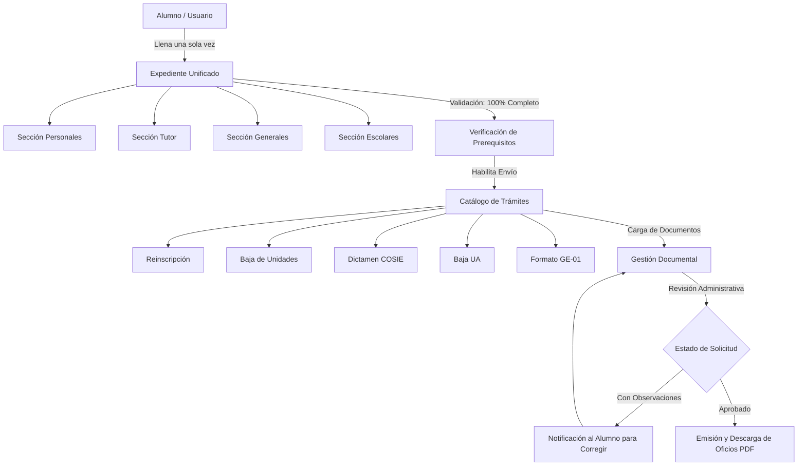

# Documentación Técnica y Lógica del Sistema GESCO
**Gestión Escolar UPIIZ - Instituto Politécnico Nacional (IPN)**

---

## 1. Visión General y Filosofía del Sistema

**GESCO** es una plataforma digital moderna diseñada para la gestión integral de trámites y expedientes escolares de los estudiantes en la **Unidad Profesional Interdisciplinaria de Ingeniería Campus Zacatecas (UPIIZ - IPN)**.

### Concepto Clave: Unificación del Expediente Escolar
En los sistemas tradicionales de gestión académica, cada trámite administrativo exige al alumno la recaptura repetitiva de datos personales, familiares y escolares, así como la entrega reiterada de documentos comunes. 

GESCO introduce una arquitectura orientada a la **Unificación del Expediente Escolar**:
- **Fuente Única de Verdad (`Expediente`)**: El estudiante completa sus datos (Personales, Tutor/Contacto de Emergencia, Generales y Escolares) una sola vez en su expediente centralizado.
- **Leído Centralmente por los Trámites**: Todos los trámites escolares (Reinscripción, Baja de Unidades de Aprendizaje, Dictamen COSIE, Baja de Unidad Académica y Formato GE-01) consumen directamente los datos e identificadores del expediente unificado.
- **Validación de Prerequisitos**: Ningún trámite puede ser enviado si el expediente escolar no cumple con el 100% de los datos requeridos o si existen inconsistencias críticas.

---

## 2. Arquitectura Técnica y Estructura del Proyecto

La aplicación está desarrollada con **Flutter** siguiendo una arquitectura modular basada en separación por capas (Core, Features y Shared Widgets), diseñada para facilitar la escalabilidad y la posterior integración con una API RESTful o backend de producción.

```
lib/
├── main.dart                      # Punto de entrada de la aplicación, configuración de MaterialApp y tema global.
├── core/
│   ├── data/                      # Repositorios de datos estáticos, catálogos y mock de pruebas.
│   │   ├── catalogos.dart         # Catálogos escolares (carreras, semestres, causas COSIE, etc.) y geográficos.
│   │   ├── codigos_postales.dart   # Búsqueda y mapeo de códigos postales en México.
│   │   ├── codigos_postales_data.dart # Base de datos embebida de C.P.
│   │   ├── datos_demo.dart        # Instancia estática del expediente y solicitudes de prueba (Ana Martínez).
│   │   └── municipios.dart        # Mapeo de estados y municipios de México.
│   ├── layout/                    # Infraestructura de responsividad y navegación.
│   │   ├── breakpoints.dart       # Definición de Form Factors (Compact, Medium, Expanded).
│   │   └── secciones.dart         # Enumeración `Seccion` de las vistas principales del sistema.
│   ├── models/                    # Modelos de datos del dominio (Data Transfer Objects y Entidades).
│   │   ├── codigo_postal_info.dart# Modelo de respuesta de búsqueda de CP.
│   │   ├── documento.dart         # Entidad de Documento adjunto y trazabilidad.
│   │   ├── expediente.dart        # Entidad principal del Expediente y Secciones.
│   │   ├── materia.dart           # Entidad de Unidad de Aprendizaje / Materia.
│   │   └── tramite.dart           # Entidad de Trámite escolar y tipos de solicitud.
│   ├── theme/                     # Sistema de diseño e identidad visual IPN/UPIIZ.
│   │   ├── app_colors.dart        # Paleta de colores institucional (Guinda IPN, Dorado, Grises).
│   │   ├── app_spacing.dart       # Constantes de espaciado, padding y border radius.
│   │   ├── app_theme.dart         # Configuración de `ThemeData` para Flutter.
│   │   └── app_typography.dart    # Estilos tipográficos del sistema.
│   └── utils/                     # Utilidades de validación y cálculo de algoritmos oficiales.
│       ├── curp.dart              # Generador y validador de CURP oficial mexicano.
│       └── validators.dart        # Validadores de formularios (Email, Boleta, Teléfono, etc.).
├── features/                      # Módulos de funcionalidades y pantallas por dominio.
│   ├── adeudos/                   # Gestión centralizada de materias reprobadas / Unidades de Aprendizaje.
│   │   └── adeudos_screen.dart
│   ├── auth/                      # Flujos de autenticación e inscripción inicial.
│   │   ├── login_screen.dart      # Inicios de sesión (Alumno / Administrador).
│   │   ├── registro_screen.dart   # Registro general.
│   │   ├── registro_datos.dart    # Contenedor del flujo de captura.
│   │   └── pasos/                 # Stepper de 7 pasos para captura de datos iniciales.
│   ├── expediente/                # Consulta y edición del Expediente Unificado.
│   │   ├── expediente_screen.dart # Vista general del expediente y secciones.
│   │   ├── editar_seccion_dialog.dart # Modal dinámico de edición de secciones.
│   │   └── completar_datos_escolares_screen.dart # Captura avanzada de datos escolares.
│   ├── home/                      # Layout principal adaptativo (Sidebar / BottomBar).
│   │   └── home_screen.dart
│   ├── inicio/                    # Dashboard inicial del alumno.
│   │   └── inicio_screen.dart
│   └── solicitudes/               # Catálogo de trámites, gestión de requisitos y descarga de oficios.
│       └── solicitudes_screen.dart
└── widgets/                       # Componentes visuales reutilizables.
    └── status_pill.dart           # Indicadores de estado visual (`StatusPill` y `StatusDot`).
```

---

## 3. Sistema Responsivo y Layout Adaptation

GESCO implementa un sistema responsivo basado en tres **Form Factors** adaptativos gestionados mediante la extensión `FormFactorContext` (`lib/core/layout/breakpoints.dart`):

| Breakpoint | Rango de Ancho | Dispositivo Típico | Componente de Navegación Principal |
| :--- | :--- | :--- | :--- |
| **Compact** | `< 600 px` | Smartphone / Móvil | `BottomNavigationBar` (Navegación inferior fija) |
| **Medium** | `600 px - 1100 px` | Tablet / Pantalla mediana | Layout de una sola columna optimizada con `BottomNavigationBar` o header |
| **Expanded** | `>= 1100 px` | Desktop / Laptop / Web | `_MenuLateral` (Sidebar lateral institucional guinda IPN) |

### Navegación Principal (`Seccion` Enum)
La navegación dentro de la app está estructurada alrededor de 4 secciones principales (`lib/core/layout/secciones.dart`):
1. **`inicio` (`InicioScreen`)**: Resumen del expediente, solicitudes activas y avance global de documentación.
2. **`expediente` (`ExpedienteScreen`)**: Módulos de datos personales, tutor, generales, escolares y mapa de uso del expediente.
3. **`solicitudes` (`SolicitudesScreen`)**: Catálogo interactivo de trámites escolares y descarga de oficios aprobados.
4. **`adeudos` (`AdeudosScreen`)**: Administración de Unidades de Aprendizaje reprobadas o con requerimiento de regularización.

---

## 4. Modelos de Datos y Lógica de Negocio Core

### 4.1. Modelo `Expediente` (`lib/core/models/expediente.dart`)
El modelo `Expediente` agrupa toda la información del alumno y evalúa automáticamente el estado de completitud:

```dart
class Expediente {
  final String alumnoId;
  final Map<SeccionExpediente, bool> seccionesCompletadas;
  final Map<String, dynamic> datosPersonales;
  final Map<String, dynamic> datosTutor;
  final Map<String, dynamic> datosGenerales;
  final Map<String, dynamic> datosEscolares;
  final List<Adeudo> adeudos;
}
```

- **`SeccionExpediente`**: Enum que representa las 4 áreas clave (`personales`, `tutor`, `generales`, `escolares`).
- **`estaCompleto`**: Getter booleano que retorna `true` únicamente cuando las 4 secciones han sido marcadas como completadas.
- **`porcentajeCompletado`**: Método que calcula el porcentaje global de avance en el expediente (0.0 a 1.0) para alimentar las barras de progreso.
- **`seccionesPendientes`**: Método que lista las secciones que aún requieren atención por parte del estudiante.

### 4.2. Modelo `Tramite` y `TipoTramite` (`lib/core/models/tramite.dart`)
Gestiona los trámites escolares disponibles en la UPIIZ:

- **`TipoTramite` Enum**:
  1. `reinscripcion`: Proceso de reinscripción al siguiente semestre académico.
  2. `bajaUnidades`: Solicitud de baja de Unidades de Aprendizaje inscritas.
  3. `dictamen`: Tramitación de Dictamen ante el Consejo Técnico Consultivo Escolar (COSIE).
  4. `bajaUnidadAcademica`: Baja definitiva o temporal de la unidad académica UPIIZ.
  5. `ge01`: Formato oficial GE-01 para gestiones diversas.

- **Requisitos Dinámicos de Documentos (`requisitosDocumentos`)**:
  Cada `TipoTramite` define exactamente qué documentos son obligatorios para su procesamiento. Por ejemplo:
  - *Reinscripción*: Comprobante de pago, Formato de reinscripción, Comprobante de NO adeudo.
  - *Dictamen COSIE*: Solicitud firmada de dictamen, Carta exposición de motivos, Historial académico/Kárdex, Evidencia justificativa.

### 4.3. Modelo `Documento` y `EstadoTramite` (`lib/core/models/documento.dart` & `lib/widgets/status_pill.dart`)
Representa cada documento digital entregado por el alumno:

- **`EstadoTramite` Enum**:
  - `aprobado`: Validado correctamente por la gestión escolar (Color Verde).
  - `enRevision`: Subido y pendiente de revisión administrativa (Color Amarillo/Naranja).
  - `conObservaciones`: Rechazado con correcciones indicadas (Color Rojo).
  - `sinSubir`: Documento pendiente de carga por el alumno (Color Gris).
  - `noAplica`: Documento no requerido para la condición particular (Color Gris neutro).

- **Propiedades Clave de `Documento`**:
  - `id`, `nombre`, `descripcion`.
  - `esObligatorio`: Indica si paraliza el trámite.
  - `archivoUrl` / `nombreArchivo`: Registro del archivo físico/digital.
  - `observaciones`: Retroalimentación del revisor administrativo cuando el estado es `conObservaciones`.
  - `aplicaParaTramite(TipoTramite)`: Algoritmo de filtrado que determina si este documento pertenece al flujo de un trámite específico.

### 4.4. Modelo `Adeudo` (`lib/core/models/materia.dart` & `lib/core/models/expediente.dart`)
Administra el registro académico de materias no acreditadas:
- `id`, `unidadAprendizaje` (Nombre de la materia).
- `nivel` (Nivel curricular 1 a 5).
- `periodoReprobada` (ej. "24/1").
- `semestreReprobada` (ej. "3º Semestre").
- `estado` (`reprobada`, `regularizada`, `enDictamen`).

---

## 5. Catálogos y Capa de Datos Mock

### 5.1. `Catalogos` (`lib/core/data/catalogos.dart`)
Proporciona la oferta académica e información institucional de la UPIIZ:
- **Carreras Oficiales UPIIZ**:
  - Ingeniería en Sistemas Computacionales
  - Ingeniería Ambiental
  - Ingeniería Mecatrónica
  - Ingeniería en Alimentos
  - Ingeniería Metalúrgica
  - Licenciatura en Inteligencia Artificial
- **Planes de Estudio, Semestres y Periodos Académicos** (ej. "27/1 - Febrero-Junio 2027").
- **Causas COSIE**: Catálogo estático para solicitudes de Dictamen (Baja por artículo, Desfasamiento, Exceso de cupo, Razones de salud/fuerza mayor).
- **Integración Geográfica**: Integración con `municipios.dart` y `codigos_postales.dart` para autocompletado regional de domicilio.

### 5.2. `DatosDemo` (`lib/core/data/datos_demo.dart`)
Ofrece un estado de prueba persistente en memoria para prototipado y demostración funcional:
- **Alumno Mock**: `Ana Martínez Gómez`
- **Boleta**: `2023670000`
- **Programa**: `Ingeniería en Sistemas Computacionales` (Semestre 4, Periodo 27/1).
- Contiene una lista presurtida de documentos con diferentes estados (`aprobado`, `enRevision`, `conObservaciones`, `sinSubir`) y solicitudes activas para probar todos los estados visuales del sistema.

---

## 6. Flujos de Pantalla y Funcionalidades

### 6.1. Autenticación y Registro (`lib/features/auth/`)
- **`LoginScreen`**: Pantalla de acceso dual (Alumno / Personal Administrativo), validación de Boleta (10 dígitos para alumnos) o Correo Institucional (`@ipn.mx` / `@alumno.ipn.mx`).
- **`RegistroScreen` & Stepper de Captura (`registro_datos.dart`)**:
  Asistente guiado de 7 etapas independientes para la creación inicial del expediente:
  1. `paso_correo.dart`: Validación de correo institucional.
  2. `paso_cuenta.dart`: Asignación de contraseña segura.
  3. `paso_personales.dart`: Nombre, CURP (con autocalculador), fecha de nacimiento, género.
  4. `paso_tutor.dart`: Datos del tutor o contacto de emergencia.
  5. `paso_generales.dart`: Domicilio con autocompletado por Código Postal.
  6. `paso_escolares.dart`: Carrera, Boleta, Plan de estudio y Semestre.
  7. `paso_foto.dart`: Carga de fotografía infantil digital oficial.

### 6.2. Dashboard Principal (`InicioScreen` - `lib/features/inicio/`)
- **Header de Bienvenida**: Muestra el nombre del alumno, boleta, carrera y avatar.
- **Tarjeta de Estatus de Expediente**: Muestra la barra de porcentaje global y el estado del expediente (`Completo` / `Incompleto`).
- **Sección de Solicitudes Activas**: Mapeo directo de trámites en curso con sus respectivas `StatusPill`.
- **Panel de Documentos Globales**: Vista rápida de todos los archivos del estudiante con barra de progreso global, filtro rápido por estado y botón para subida rápida.

### 6.3. Expediente Unificado (`ExpedienteScreen` - `lib/features/expediente/`)
- **Tarjetas de Secciones**: 4 tarjetas interactivas (`Personales`, `Tutor`, `Generales`, `Escolares`). Cada una indica su estado (`Completado` o `Incompleto`).
- **Diálogo Dinámico de Edición (`EditarSeccionDialog`)**: Formulario emergente adaptativo para editar cualquier campo del expediente sin perder el contexto.
- **Captura Avanzada de Datos Escolares (`CompletarDatosEscolaresScreen`)**: Pantalla completa para la verificación detallada de datos académicos.
- **Resumen de Adeudos**: Indicador visual de materias pendientes de regularización.
- **Mapa de Uso del Expediente**: Diagrama interactivo explicativo que muestra al alumno cómo sus 4 secciones nutren automáticamente a los 5 trámites escolares.

### 6.4. Gestión de Trámites y Requisitos (`SolicitudesScreen` - `lib/features/solicitudes/`)
- **Catálogo de los 5 Trámites**: Tarjetas desplegables para Reinscripción, Baja de Unidades, Dictamen COSIE, Baja de UA y GE-01.
- **Bloqueo Inteligente de Prerequisitos**: Si el expediente del alumno está incompleto, la opción de "Enviar Solicitud" permanece deshabilitada, indicando al alumno qué secciones del expediente debe completar primero.
- **Gestión de Documentos por Trámite**: Muestra la lista de archivos específicos requeridos para el trámite seleccionado. Permite subir archivos, ver archivos adjuntos y leer las **observaciones de rechazo/corrección** emitidas por la gestión escolar.
- **Sección de Descarga de Oficios**: Espacio dedicado donde el alumno puede descargar los archivos PDF firmados digitalmente (Dictámenes aprobados, Acuses de baja, Comprobantes de reinscripción) una vez que el trámite alcanza el estado `aprobado`.

### 6.5. Gestión de Adeudos (`AdeudosScreen` - `lib/features/adeudos/`)
- **Módulos de Materias Reprobadas**: Listado en formato tarjeta de las Unidades de Aprendizaje no acreditadas.
- **Filtros por Estado**: Visualización categorizada de materias reprobadas, en proceso de dictamen o regularizadas.
- **Solicitud de Regularización (`pedirAdeudo`)**: Formulario para solicitar la inclusión de una materia reprobada en el siguiente periodo o proceso de dictamen COSIE.

---

## 7. Identidad Visual y Sistema de Diseño

El sistema de diseño implementa rigurosamente los lineamientos de identidad gráfica del **Instituto Politécnico Nacional (IPN)** y la **UPIIZ**:

- **Paleta de Colores (`AppColors`)**:
  - `ipnBurgundy` (`#682444`): Color primario institucional (Guinda IPN).
  - `ipnGold` (`#D4A373` / `#B8860B`): Accento dorado institucional.
  - `statusAprobado` (`#2E7D32`): Verde para estados aprobados o completados.
  - `statusRevision` (`#EF6C00`): Naranja para estados en revisión.
  - `statusObservaciones` (`#C62828`): Rojo para requerimiento de observaciones/correcciones.
  - `statusPendiente` (`#757575`): Gris para elementos sin subir o pendientes.

- **Componentes Visuales de Estado (`StatusPill` & `StatusDot`)**:
  Garantizan la consistencia semántica en todas las pantallas del sistema, emparejando automáticamente cada `EstadoTramite` con su texto legible, color de fondo, color de texto e icono distintivo.

---

## 8. Resumen de Flujo de Datos


